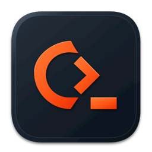

<p align="center">
  
</p>

<h1 align="center">Cadex</h1>

<p align="center">
  Um workspace de desenvolvimento centrado no terminal, nativo e leve.<br>
  Terminal, editor de código, explorador de arquivos, git com grafo e previews (web, Markdown, imagem,
  vídeo, áudio e PDF) numa janela só. <b>Sem telemetria, sem conta, sem IA embutida:</b> rode os seus
  agentes de código numa aba de terminal.
</p>

<p align="center">
  <a href="https://github.com/c4duZ/cadex/releases/latest/download/Cadex.dmg"></a>
  <a href="#instalar-no-windows"></a>
</p>

<p align="center">
  <sub>Grátis e de código aberto (MIT) · 9 MB no Mac, 4 MB no Windows · em inglês ou português · <a href="#instalar-no-mac">instalar no Mac</a> · <a href="#instalar-no-windows">instalar no Windows</a></sub>
</p>

---

## O que é

O Cadex junta num app nativo do macOS e do Windows o que um dia de trabalho com agentes de código pede: o terminal
onde eles rodam, e em volta dele os arquivos, o código, o git e os previews, tudo alcançável pelo ⌘K.

- **Terminal** rápido e nítido (modelo da [libghostty](https://github.com/ghostty-org/ghostty),
  desenho em Metal), com abas, divisões, busca, links e colagem de imagens.
- **Documentos ao lado do terminal:** código, Markdown, mídia, diffs, histórico e previews abrem
  num painel da mesma aba (ou em aba própria, se preferir), divididos como terminais.
- **Spaces:** grupos de abas com nome, que voltam como estavam ao reabrir o app.
- **Explorador e busca** de arquivos por nome e por conteúdo, respeitando o `.gitignore`.
- **Editor de código** com destaque de sintaxe (tree-sitter), números de linha e dobras.
- **Markdown** renderizado, com links entre notas, links quebrados e quem aponta pra cá.
- **Git:** mudanças, stage, commit, push e pull, diff lado a lado e o grafo do histórico.
- **Previews:** servidores locais e páginas web, imagem, vídeo, áudio e PDF.
- **Agentes à vista** (Mac): a página Agents mostra as sessões do Claude Code rodando em todas as
  contas deste Mac, por projeto, com o estado (trabalhando, esperando você) e os subagentes. Um clique
  num subagente abre a conversa dele numa aba, no jeito do Claude Code; um duplo clique na sessão
  vai ao terminal dela. Uma notificação avisa quando um agente pede permissão, pergunta ou termina.
  O Cadex só lê: não manda prompt nem fala com modelo.
- **Uso dos planos** (Mac): a página Accounts mostra quanto cada conta do Claude Code e do Codex usou
  da sessão de 5 horas e da semana, e quando reinicia; um clique abre o agente daquela conta.
- **Barra lateral e barra de status do seu jeito** (Mac): os ícones do topo da barra lateral (Files,
  Search, Git, Git History, Agents, Accounts) e os itens da barra de status (pasta, branch,
  terminais, agentes, uso, RAM, CPU, memória do Cadex, portas abertas, hosts SSH) são escolhidos e
  arrastados para o lugar; o que fica desligado não pesa nada.
- **Hosts SSH** (Mac): os do `~/.ssh/config`, se respondem, e um clique conecta numa aba.
- **Escolher elemento para o agente** (Mac): no preview web, `⇧⌘C` e um clique mandam o elemento
  para o terminal do agente, com o arquivo e a linha onde ele foi escrito (React, Next, Vue, Svelte)
  e um print dele.
- **Temas:** centenas, com busca, importação e pasta própria; claro e escuro, cor de destaque, alto
  contraste, zoom da interface, cores de space e de aba, imagem de fundo e vibrância.
- **Atualiza sozinho** (Mac): avisa quando sai versão nova e atualiza com um clique, conferindo a
  assinatura antes de trocar o app.
- **Inglês por padrão**, português nas configurações.

## Instalar no Mac

<table>
  <tr>
    <td align="center" width="33%"><h3>1</h3><b>Baixe</b></td>
    <td align="center" width="33%"><h3>2</h3><b>Arraste para Aplicativos</b></td>
    <td align="center" width="33%"><h3>3</h3><b>Abra</b></td>
  </tr>
  <tr>
    <td valign="top">Clique em <a href="https://github.com/c4duZ/cadex/releases/latest/download/Cadex.dmg"><b>Baixar para Mac</b></a>. Vem sempre a versão mais recente.</td>
    <td valign="top">Abra o <code>Cadex.dmg</code> e arraste o ícone do Cadex para a pasta <b>Aplicativos</b>.</td>
    <td valign="top">Na primeira vez, o macOS avisa que não pode verificar o app: vá em <b>Ajustes do Sistema → Privacidade e Segurança</b> e clique em <b>Abrir Mesmo Assim</b>. Depois disso ele abre direto.</td>
  </tr>
</table>

Requisitos: macOS 13 ou superior, Intel ou Apple Silicon. Tudo o que o Cadex usa vem dentro do app: não
precisa instalar Xcode, Homebrew nem nada antes, e funciona offline. Depois de instalado, o próprio
Cadex avisa quando há versão nova e se atualiza com um clique.

### Pelo terminal

Um comando baixa a última versão, confere o checksum e coloca o Cadex em Aplicativos, sem pedir
senha e sem o aviso da primeira abertura:

```bash
curl -fsSL https://github.com/c4duZ/cadex/releases/latest/download/install.sh | sh
```

O script é curto e dá para ler antes de rodar: [`install.sh`](apps/macos/packaging/install.sh). Rodar
de novo atualiza para a versão mais recente.

<details>
<summary><b>Problemas na instalação?</b></summary>

- **O macOS não deixa abrir na primeira vez:** o Cadex ainda não é notarizado pela Apple. Vá em Ajustes do Sistema → Privacidade e Segurança → **Abrir Mesmo Assim**, ou rode `xattr -dr com.apple.quarantine /Applications/Cadex.app`.
- **O comando instalou em `~/Applications`:** a pasta Aplicativos do sistema não aceitou a cópia sem senha; o Cadex funciona igual de lá.
- **O botão de baixar dá 404:** enquanto o repositório for privado, os downloads só funcionam para quem tem acesso a ele e está logado no GitHub.
- **Versões anteriores:** na [página de releases](https://github.com/c4duZ/cadex/releases).

</details>

## Instalar no Windows

> **Prévia.** O Windows sai na mesma release do Mac, com quase todas as features (menos o seletor de
> elementos e a atualização dentro do app) e ainda pouco usado.
> Se algo falhar, [abra uma issue](https://github.com/c4duZ/cadex/issues) contando o que aconteceu.

No PowerShell, um comando baixa a última versão, confere o checksum e instala o Cadex para o seu
usuário, com atalho no Menu Iniciar, sem pedir administrador:

```powershell
irm https://github.com/c4duZ/cadex/releases/latest/download/install.ps1 | iex
```

O script escolhe sozinho entre x64 e ARM64 e é curto para ler antes de rodar:
[`install.ps1`](apps/windows/packaging/install.ps1). Rodar de novo atualiza para a versão mais recente
(no Windows, o app ainda não se atualiza sozinho).

Prefere sem instalar? Baixe o ZIP portátil, extraia e abra o `Cadex.exe`:
[x64 (Intel e AMD)](https://github.com/c4duZ/cadex/releases/latest/download/Cadex-windows-x64.zip) ·
[ARM64 (Snapdragon)](https://github.com/c4duZ/cadex/releases/latest/download/Cadex-windows-arm64.zip).

Requisitos: Windows 11, x64 ou ARM64. O terminal abre o PowerShell (ou o shell que você escolher, e
as distros do WSL); o Git usa o [Git for Windows](https://git-scm.com/download/win), se estiver
instalado. O preview web e os de mídia usam o WebView2, que já vem no Windows 11.

<details>
<summary><b>Problemas na instalação?</b></summary>

- **O Windows avisa "O Windows protegeu o computador" ao abrir o ZIP:** o Cadex ainda não é assinado. Clique em **Mais informações → Executar assim mesmo**. Pelo comando do PowerShell o aviso não aparece.
- **Para desinstalar:** Configurações → Apps → Aplicativos instalados → Cadex → Desinstalar. Suas configurações em `%APPDATA%\Cadex` ficam.
- **Atalhos:** são os do Mac com ⌘ virando Ctrl+Shift (⌘T é Ctrl+Shift+T, ⌘K é Ctrl+Shift+K), como no Windows Terminal.

</details>

## Atalhos

Toda ação do Cadex é um comando: o **⌘K** acha e roda qualquer uma, e os atalhos podem ser trocados
nas configurações. No Windows vale uma regra só, para o mesmo `settings.json` servir nas duas
máquinas: ⌘ vira Ctrl+Shift (como no Windows Terminal), e ⌘ com ⇧, ⌥ ou ⌃ vira Ctrl+Shift+Alt.

| Ação | Mac | Windows |
|---|---|---|
| Paleta de comandos | `⌘K` | `Ctrl+Shift+K` |
| Nova aba / fechar painel | `⌘T` / `⌘W` | `Ctrl+Shift+T` / `Ctrl+Shift+W` |
| Nova janela | `⌘N` | pela paleta (sem atalho) |
| Manter acordado (ligar ou desligar) | `⇧⌘A` | `Ctrl+Shift+Alt+A` |
| Dividir à direita / para baixo | `⌘D` / `⌘⇧D` | `Ctrl+Shift+D` / `Ctrl+Shift+Alt+D` |
| Ir para a aba 1…9 | `⌘1…9` | `Ctrl+Shift+1…9` |
| Abrir arquivo por nome / buscar no conteúdo | `⌘P` / `⌘⇧F` | `Ctrl+Shift+P` / `Ctrl+Shift+Alt+F` |
| Abrir pasta | `⌘O` | `Ctrl+Shift+O` |
| Painel lateral / arquivos / git | `⌘B` / `⌘⇧E` / `⌘⇧G` | `Ctrl+Shift+B` / `Ctrl+Shift+Alt+E` / `Ctrl+Shift+Alt+G` |
| Preview web | `⌘⇧H` | `Ctrl+Shift+Alt+H` |
| Agents / ícone 1…9 da barra lateral | `⌘⇧J` / `⌃⌘1…9` | só no Mac |
| Escolher elemento no preview / parar | `⌘⇧C` / `Esc` | só no Mac |
| Histórico do git | pela paleta (sem atalho) | pela paleta (sem atalho) |
| Trocar de space / novo space | `⌘⇧S` / `⌃⌘N` | `Ctrl+Shift+Alt+S` / `Ctrl+Shift+Alt+N` |
| Próximo / anterior space | `⌃⌘→` / `⌃⌘←` | `Ctrl+Shift+Alt+PgDn` / `Ctrl+Shift+Alt+PgUp` |
| Buscar no terminal / limpar | `⌘F` / `⌘L` | `Ctrl+Shift+F` / `Ctrl+Shift+L` |
| Copiar / colar no terminal | `⌘C` / `⌘V` | `Ctrl+Shift+C` / `Ctrl+Shift+V` (ou `Ctrl+C` com texto selecionado) |
| Configurações | `⌘,` | `Ctrl+Shift+,` |

## Tamanho e memória

Métrica do projeto, medida a cada release ([ADR 0007](docs/adr/0007-one-step-install.md)).
Tamanhos da versão 2.2.0 (2026-10-22); memória medida na 0.1.0 (2026-10-19), num Mac com M4 e macOS 27:

| | Cadex |
|---|---|
| download (DMG) | 9,4 MB |
| download (ZIP do instalador) | 9,8 MB |
| download Windows (ZIP x64 / ARM64) | 3,9 MB / 3,7 MB |
| app instalado (universal: Apple Silicon e Intel) | 46 MB |
| memória com um terminal aberto (footprint) | 66 MB |
| cada aba de terminal a mais, escondida (2.2.0) | 1 MB |
| tudo da barra lateral e da barra de status ligado (2.2.0) | +7% |

O app instalado leva as duas arquiteturas e as 18 gramáticas do
tree-sitter compiladas dentro (as tabelas delas são 15 MB de cada fatia); o download comprimido fica
abaixo. O pico de memória ao abrir foi 111 MB.

## Arquitetura

```
                    ┌──────────────────────────────────────┐
                    │          Núcleo (Zig, API C)         │
                    │                                      │
                    │  terminal ── libghostty-vt           │
                    │  explorer · search · source-control  │
                    │  git-history · editor (tree-sitter)  │
                    │  markdown (índice de links)          │
                    │  workspace                           │
                    └──────────────────▲───────────────────┘
                                       │ API C
               ┌───────────────────────┴───────────────────────┐
               │                                               │
  ┌────────────┴────────────┐                    ┌─────────────┴────────────┐
  │   App macOS (Swift)     │                    │   App Windows (Zig)      │
  │   AppKit · Metal        │                    │   Win32 · Direct3D 11    │
  │   PDFKit · AVKit ·      │                    │   Direct2D · DirectWrite │
  │   ImageIO · Quick Look  │                    │   WIC · WebView2         │
  └─────────────────────────┘                    └──────────────────────────┘
```

- **Núcleo:** toda a lógica que não depende de plataforma, escrita uma vez em Zig. O modelo do
  terminal é a [libghostty-vt](https://github.com/ghostty-org/ghostty).
- **App:** uma interface nativa e fina por sistema. Desenha, recebe entrada e chama o núcleo.
  Previews de mídia usam os frameworks do próprio sistema, sem peso extra.

O porquê de cada escolha está nos ADRs:
[macOS primeiro e app nativo](docs/adr/0001-macos-first-native-app.md) ·
[núcleo em Zig](docs/adr/0002-zig-core-with-c-api.md) ·
[libghostty-vt](docs/adr/0003-libghostty-vt-terminal-model.md) ·
[reescrita do zero](docs/adr/0004-clean-rewrite.md) ·
[Windows em Zig e Win32](docs/adr/0012-windows-zig-win32-d3d11.md).

## Organização do repositório

```
core/             núcleo em Zig
  shared/         o que 2+ features do núcleo usam
  features/<x>/   uma pasta por feature, com CLAUDE.md e testes
apps/macos/       app Swift
  shared/         o que 2+ features do app usam
  features/<x>/   uma pasta por feature, mesmos nomes do núcleo
apps/windows/     app Windows em Zig (Win32, Direct3D 11, Direct2D)
  shared/         o que 2+ features do app usam
  features/<x>/   uma pasta por feature, mesmos nomes do Mac
docs/             vocabulário, decisões (adr/) e spec de comportamento (spec/)
tools/            verificações do repositório
```

Cada feature tem um `CLAUDE.md` curto com a responsabilidade, os pontos de entrada, as regras e como
testar. O repositório segue um método de organização para trabalho com agentes de IA: estrutura por
feature, manifestos curtos por pasta e verificação executável.

## Desenvolvimento

Requisitos: macOS 13+, as Command Line Tools (Swift 6; o Xcode completo não é preciso) e Zig 0.16.

```bash
make check     # manifestos + testes do núcleo + testes do app
make run       # compila e abre o app
make package   # gera dist/Cadex.app universal (Intel + Apple Silicon), assinado ad hoc
make perf      # orçamento de peso: o app de release nas situações que já o deixaram pesado
make windows-app      # compila o app Windows (x64 e ARM64) daqui do Mac
make windows-package  # gera os ZIPs do Windows e o install.ps1 em dist/
```

O identificador `io.github.c4duz.cadex` é fixo na assinatura para o macOS manter as permissões dadas
ao Cadex entre um build e outro.

### Publicar uma versão

```bash
# 1. Suba CFBundleShortVersionString (ex.: 0.2.0) e CFBundleVersion (inteiro, sempre maior)
#    em apps/macos/packaging/Info.plist
# 2. Gere e publique (requer: brew install create-dmg, o gh logado na conta dona do repositório
#    e a chave de atualização no Keychain, item cadex-update-signing, ou CADEX_UPDATE_KEY no .env)
apps/macos/packaging/release.sh --publish "O que mudou nesta versão"
```

O script gera o `Cadex.dmg`, o `Cadex.zip` com o checksum, o `install.sh` e o `latest.json` assinado
que o app lê para se atualizar ([ADR 0016](docs/adr/0016-in-app-updates.md)), e cria a release
`vX.Y.Z`. Sem a chave de atualização ele não publica. Os arquivos sobem com nome fixo, sem a versão, para o botão de download e o comando de
instalação do topo sempre pegarem a última. Sem `--publish`, ele só gera os arquivos em `dist/`. Com `CADEX_WINDOWS=1`, a mesma release leva os
ZIPs do Windows e o `install.ps1`.

## Licença

[MIT](LICENSE), © 2026 Carlos Teixeira. Componentes de terceiros estão listados em [`NOTICE`](NOTICE).
