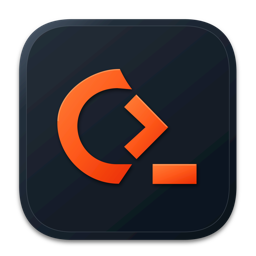

<p align="center">
  
</p>

<h1 align="center">Cadex</h1>

<p align="center">
  Um workspace de desenvolvimento centrado no terminal, nativo e leve.<br>
  Terminal, código, git e previews numa janela só, feita para trabalhar com agentes de código.<br>
  <b>Sem telemetria, sem conta, sem IA embutida:</b> os seus agentes rodam numa aba de terminal.
</p>

<p align="center">
  <a href="https://github.com/c4duZ/cadex/releases/latest/download/Cadex.dmg"></a>
  <a href="#instalar-no-windows"></a>
</p>

<p align="center">
  <sub>Grátis e de código aberto (MIT) · 31 MB para baixar no Mac, 4 MB no Windows · em inglês ou português · <a href="#instalar-no-mac">instalar no Mac</a> · <a href="#instalar-no-windows">instalar no Windows</a></sub>
</p>

---

## O que é

O Cadex junta num app nativo o que um dia de trabalho com agentes de código pede: o terminal onde
eles rodam e, em volta dele, os arquivos, o código, o git e os previews. Toda ação é um comando que
o **⌘K** acha e roda. Algumas features ainda são só do Mac; elas estão marcadas.

### O terminal e a janela
- **Terminal rápido e nítido:** modelo da [libghostty](https://github.com/ghostty-org/ghostty),
  desenho em Metal, abas, divisões, busca, links e colagem de imagens.
- **Projetos:** a pasta de um repositório com as abas abertas nela, que voltam como estavam ao
  reabrir. A página do projeto mostra as tarefas, o gasto da semana, a memória e as conversas.
- **Barra lateral** (Mac): **Trabalho**, cada projeto com os terminais abertos e o estado do agente
  de cada um, e **Arquivos**, a árvore e as mudanças do git. `⌘B` a esconde e a barra de cima sobe
  junto, deixando a janela para os terminais.
- **Painéis:** código, Markdown, mídia, diffs e previews abrem ao lado do terminal, na mesma aba.
  Cada painel tem um cabeçalho com o agente que roda nele (Mac), e arrastar o cabeçalho rearruma.
- **Navegação rápida** (Mac): `⌘J` pula para qualquer tarefa ou terminal do Cadex; a gaveta
  (`` ⌥⌘` ``) guarda terminais rápidos fora de projeto; sem projeto aberto, a tela de início.

### Código e git
- **Editor** com destaque de sintaxe (tree-sitter), números de linha e dobras.
- **Markdown** renderizado, com links entre notas, links quebrados e quem aponta pra cá.
- **Busca** de arquivos por nome e por conteúdo, respeitando o `.gitignore`.
- **Git:** mudanças, stage, commit, push e pull, diff lado a lado e o grafo do histórico.
- **Previews:** servidores locais e páginas web, imagem, vídeo, áudio e PDF.
- **Revisão** (Mac): uma aba por tarefa com tudo o que o agente mudou, stage por linha, conflito em
  três vias, comentários mandados ao agente num texto só e as linhas que ele escreveu marcadas
  ([ADR 0027](docs/adr/0027-local-authorship.md)).

### Agentes (Mac)
O Cadex não fala com modelo: ele observa os agentes que rodam nos terminais e, quando você escreve
um pedido, abre o agente com o seu texto ([ADR 0019](docs/adr/0019-agents-observe-only.md),
[ADR 0033](docs/adr/0033-cadex-launches-agents.md)).
- **Estado à vista:** cada terminal mostra se o agente trabalha, espera você ou terminou, contado
  pelo próprio Claude Code. Uma notificação avisa quando ele pede permissão, pergunta ou termina.
- **Uma tarefa, uma worktree:** "New Task" (`⌘N`) cria o branch e a worktree, copia o `.env` e afins
  (`.worktreeinclude`), roda os hooks de preparo e abre o agente nela.
- **O Claude volta ao reabrir:** fechar o Cadex ou reiniciar o Mac traz cada aba com o Claude que
  rodava nela, na mesma conversa, conta e flags. Agentes parados há 30 minutos hibernam e voltam
  quando você abre a aba.
- **Contas e uso:** várias contas do Claude Code e do Codex, com o uso da sessão e da semana de cada
  uma na barra de status, sem ler login nem token ([ADR 0021](docs/adr/0021-cadex-managed-accounts.md)).
  Trocar a conta de um Claude leva a mesma conversa; o histórico junta as conversas de todas as contas.
- **O agente usa o Cadex:** nas sessões que o Cadex abre, o agente tem o comando `cadex` e um servidor
  MCP para abrir arquivos e diffs ao lado, avisar você, marcar a tarefa e usar o preview como
  navegador ([ADR 0024](docs/adr/0024-agent-tools.md), [ADR 0025](docs/adr/0025-agent-drives-preview.md)).
  No preview, `⇧⌘C` e um clique mandam um elemento da página ao agente, com o arquivo e a linha dele.
- **Outros apps do Mac** (desligado por padrão): o agente opera outros apps pela acessibilidade, com a
  sua permissão app por app ([ADR 0026](docs/adr/0026-computer-use.md)).

### A memória do projeto (Mac)
O que cada sessão de agente fez, as decisões e as armadilhas passam para a próxima, de uma conta para
outra e do Claude para o Codex. O engine é o do [ai-memory](https://github.com/akitaonrails/ai-memory),
num processo que só existe enquanto há sessão de agente; quem escreve as páginas é o Claude da
própria sessão, sem chave nem custo extra. A página Memória, no pé da barra lateral, mostra os
projetos, as páginas, a busca, o grafo e a saúde do engine ([ADR 0028](docs/adr/0028-project-memory.md)).

### Vários agentes de uma vez (Mac, desligado por padrão)
- **Corrida:** a mesma tarefa em 2 a 6 agentes, cada um na sua worktree, lado a lado; você compara e
  escolhe o vencedor.
- **Execução:** tarefas encadeadas, com dependências e portões, despachadas a agentes que reportam
  pelo `cadex`, coordenadas por você ou por um agente.
- **Automação:** um prompt num horário, mesmo com o Cadex fechado, com histórico
  ([ADR 0034](docs/adr/0034-scheduled-automations.md)).

Tudo tem teto de gasto, de duração e de agentes, e o Cadex mostra antes o que vai rodar e onde.

### Outras máquinas (Mac)
- **SSH:** os hosts do `~/.ssh/config`, se respondem, e um clique conecta numa aba.
- **Tailscale** (opcional): as máquinas da sua tailnet, rodar uma tarefa em outra máquina, o Docker de
  outra máquina numa aba e um ambiente por tarefa (`.cadex/environment.toml`)
  ([ADR 0030](docs/adr/0030-installed-tailscale.md), [ADR 0031](docs/adr/0031-run-on-remote.md),
  [ADR 0032](docs/adr/0032-workspace-recipes.md)).
- **Terminais que sobrevivem ao app** (desligado por padrão): os terminais seguem rodando com o Cadex
  fechado, e o celular entra neles por SSH ([ADR 0022](docs/adr/0022-terminal-daemon.md),
  [guia do celular](docs/guides/phone.md)).

### Do seu jeito
- **Temas:** centenas, com busca e importação; claro e escuro, cor de destaque, alto contraste,
  janela translúcida e imagem de fundo. A tela cheia do Cadex (Mac) deixa o fundo de tela aparecer
  atrás da janela translúcida.
- **Barra de status:** escolha e arraste os itens; o que fica desligado não pesa nada.
- **Tudo é arquivo de texto:** as configurações e os atalhos no `settings.json`, as automações e os
  temas em arquivos, que o Cadex relê na hora. Um agente configura o Cadex editando-os
  ([guia](docs/guides/settings.md)).
- **Atualiza sozinho** (Mac): avisa da versão nova e troca o app com um clique, conferindo a assinatura.

## Instalar no Mac

<table>
  <tr>
    <td align="center" width="33%"><h3>1</h3><b>Baixe</b></td>
    <td align="center" width="33%"><h3>2</h3><b>Arraste para Aplicativos</b></td>
    <td align="center" width="33%"><h3>3</h3><b>Abra</b></td>
  </tr>
  <tr>
    <td valign="top">Clique em <a href="https://github.com/c4duZ/cadex/releases/latest/download/Cadex.dmg"><b>Baixar para Mac</b></a>. Vem sempre a versão mais recente.</td>
    <td valign="top">Abra o <code>Cadex.dmg</code> e arraste o ícone do Cadex para a pasta <b>Aplicativos</b>.</td>
    <td valign="top">Na primeira vez, o macOS avisa que não pode verificar o app: vá em <b>Ajustes do Sistema → Privacidade e Segurança</b> e clique em <b>Abrir Mesmo Assim</b>. Depois disso ele abre direto.</td>
  </tr>
</table>

Requisitos: macOS 13 ou superior, Intel ou Apple Silicon. Tudo o que o Cadex usa vem dentro do app:
não precisa de Xcode nem Homebrew, e funciona offline.

**Pelo terminal**, um comando baixa a última versão, confere o checksum e põe o Cadex em Aplicativos,
sem senha e sem o aviso da primeira abertura (o script é curto: [`install.sh`](apps/macos/packaging/install.sh)):

```bash
curl -fsSL https://github.com/c4duZ/cadex/releases/latest/download/install.sh | sh
```

<details>
<summary><b>Problemas na instalação?</b></summary>

- **O macOS não deixa abrir na primeira vez:** o Cadex ainda não é notarizado pela Apple. Vá em Ajustes do Sistema → Privacidade e Segurança → **Abrir Mesmo Assim**, ou rode `xattr -dr com.apple.quarantine /Applications/Cadex.app`.
- **O comando instalou em `~/Applications`:** a pasta Aplicativos do sistema não aceitou a cópia sem senha; o Cadex funciona igual de lá.
- **Versões anteriores:** na [página de releases](https://github.com/c4duZ/cadex/releases).

</details>

## Instalar no Windows

> **Prévia.** O Windows sai na mesma release do Mac, com o terminal, o código, o git e os previews, e
> ainda pouco usado. As features marcadas "Mac" acima não estão nele. Se algo falhar,
> [abra uma issue](https://github.com/c4duZ/cadex/issues).

No PowerShell, um comando baixa a última versão, confere o checksum e instala para o seu usuário,
sem administrador (o script: [`install.ps1`](apps/windows/packaging/install.ps1)):

```powershell
irm https://github.com/c4duZ/cadex/releases/latest/download/install.ps1 | iex
```

Ou o ZIP portátil, para extrair e abrir o `Cadex.exe`:
[x64](https://github.com/c4duZ/cadex/releases/latest/download/Cadex-windows-x64.zip) ·
[ARM64](https://github.com/c4duZ/cadex/releases/latest/download/Cadex-windows-arm64.zip).

Requisitos: Windows 11, x64 ou ARM64. O terminal abre o PowerShell, outro shell ou uma distro do WSL;
o git usa o [Git for Windows](https://git-scm.com/download/win), se instalado.

<details>
<summary><b>Problemas na instalação?</b></summary>

- **"O Windows protegeu o computador" ao abrir o ZIP:** o Cadex ainda não é assinado. Clique em **Mais informações → Executar assim mesmo**. Pelo PowerShell o aviso não aparece.
- **Desinstalar:** Configurações → Apps → Aplicativos instalados → Cadex. Suas configurações em `%APPDATA%\Cadex` ficam.

</details>

## Atalhos

Os principais, no Mac. No Windows vale uma regra só, para o mesmo `settings.json` servir nas duas
máquinas: ⌘ vira Ctrl+Shift (⌘T é Ctrl+Shift+T), e ⌘ com ⇧, ⌥ ou ⌃ vira Ctrl+Shift+Alt. Todos os
comandos, com o atalho de cada um, estão em [`docs/guides/commands.md`](docs/guides/commands.md), e
qualquer atalho pode ser trocado.

| Ação | Atalho |
|---|---|
| Paleta de comandos | `⌘K` |
| Nova tarefa / pular para tarefa ou terminal | `⌘N` / `⌘J` |
| Nova aba / fechar painel / nova janela | `⌘T` / `⌘W` / `⇧⌘N` |
| Dividir à direita / para baixo / maximizar o painel | `⌘D` / `⇧⌘D` / `⇧⌘↩` |
| Próxima / anterior aba | `⇧⌘]` / `⇧⌘[` |
| Barra lateral / Trabalho / Arquivos / alternar | `⌘B` / `⇧⌘1` / `⇧⌘2` / `⌘E` |
| Trocar de projeto / abrir projeto / próximo e anterior | `⇧⌘S` / `⌃⌘N` / `⌃⌘→` `⌃⌘←` |
| Arquivo por nome / buscar no conteúdo / abrir pasta | `⌘P` / `⇧⌘F` / `⌘O` |
| Git / histórico do git | `⇧⌘G` / `⇧⌘L` |
| A gaveta / levar o terminal ao projeto | `` ⌥⌘` `` / `⌘↩` |
| Abrir o agente de uma conta / uso das contas | `⇧⌘A` / `⇧⌘U` |
| Preview web / escolher elemento | `⇧⌘H` / `⇧⌘C` |
| Buscar no terminal / limpar | `⌘F` / `⌘L` |
| Tela cheia | `⌃⌘F` |
| Configurações | `⌘,` |

## Configurar

As escolhas ficam em arquivos de texto, que o Cadex relê sozinho: as preferências e os atalhos em
`~/Library/Application Support/Cadex/settings.json`, as automações e os temas em pastas ao lado, e o
ambiente de um repositório em `.cadex/environment.toml`. A janela de configurações (`⌘,`) edita o
mesmo arquivo. Para pedir a um agente que mude algo, ele lê a referência completa com
`cadex skills get settings`; o resumo em português está em [`docs/guides/settings.md`](docs/guides/settings.md).

## Tamanho e memória

Métrica do projeto, conferida a cada release ([ADR 0007](docs/adr/0007-one-step-install.md)), num Mac
com M4. Entre parênteses, a versão ou o plano em que foi medido:

| | Cadex |
|---|---|
| download no Mac (DMG ou ZIP, 3.1.3) | 31 MB |
| download no Windows (ZIP x64 / ARM64, 2.2.1) | 3,9 MB / 3,7 MB |
| app instalado no Mac (universal, com o engine da memória, 3.1.3) | 91 MB |
| memória com um terminal aberto (0.1.0) | 66 MB |
| cada aba de terminal a mais, escondida (2.2.0) | 1 MB |
| o processo da memória com sessão de agente, sem o modelo de busca (plano 22) | 13 MB |
| uma corrida de 3 e uma execução de 5 tarefas abertas (plano 24) | 141–160 MB |

O app leva as duas arquiteturas, as gramáticas do tree-sitter e o engine da memória dentro; sem
sessão de agente, o processo da memória nem existe. O `make perf` mede as situações que já deixaram
o app pesado e falha acima do limite.

## Arquitetura

```
                    ┌──────────────────────────────────────┐
                    │          Núcleo (Zig, API C)         │
                    │  terminal ── libghostty-vt           │
                    │  explorer · search · source-control  │
                    │  git-history · editor · markdown     │
                    │  workspace · agent-tools (`cadex`)   │
                    │  memory ── `cadex-memory` (Rust)     │
                    └──────────────────▲───────────────────┘
                                       │ API C
               ┌───────────────────────┴───────────────────────┐
  ┌────────────┴────────────┐                    ┌─────────────┴────────────┐
  │   App macOS (Swift)     │                    │   App Windows (Zig)      │
  │   AppKit · Metal        │                    │   Win32 · Direct3D 11    │
  │   PDFKit · AVKit        │                    │   DirectWrite · WebView2 │
  └─────────────────────────┘                    └──────────────────────────┘
```

- **Núcleo:** a lógica que não depende de sistema, escrita uma vez em Zig. Gera também o `cadex`, o
  programa que as sessões de agente rodam (status line, hooks, comandos, skills e MCP), e o
  `cadex-terminald`, que guarda os terminais quando essa opção está ligada. A memória é a exceção: o
  engine do ai-memory, em Rust, num executável à parte.
- **Apps:** uma interface nativa e fina por sistema, que desenha, recebe entrada e chama o núcleo.

O porquê de cada escolha está nos [ADRs](docs/adr/): [app nativo, macOS primeiro](docs/adr/0001-macos-first-native-app.md) ·
[núcleo em Zig](docs/adr/0002-zig-core-with-c-api.md) · [libghostty-vt](docs/adr/0003-libghostty-vt-terminal-model.md) ·
[reescrita do zero](docs/adr/0004-clean-rewrite.md) · [Windows em Zig e Win32](docs/adr/0012-windows-zig-win32-d3d11.md).

## Desenvolvimento

```
core/            núcleo em Zig: shared/ e features/<feature>/
apps/macos/      app Swift: shared/ e features/<feature>/, mesmos nomes do núcleo
apps/windows/    app Windows em Zig, mesmos nomes do Mac
docs/            vocabulário, decisões (adr/), comportamento (spec/), planos e guias
tools/           verificações do repositório
```

Cada feature tem um `CLAUDE.md` curto com o que ela faz, as regras e como testar; a regra geral está
no [`CLAUDE.md`](CLAUDE.md) da raiz.

Requisitos: macOS 13+, as Command Line Tools (Swift 6, sem o Xcode completo), Zig 0.16 e, para o
engine da memória, o Rust do [rustup](https://rustup.rs).

```bash
make check            # manifestos, testes do núcleo, da memória e do app, build do Windows
make run              # compila e abre o app
make package          # dist/Cadex.app universal, assinado ad hoc
make perf             # o orçamento de peso
make windows-package  # os ZIPs do Windows e o install.ps1 em dist/
```

### Publicar uma versão

1. Suba `CFBundleShortVersionString` e `CFBundleVersion` em `apps/macos/packaging/Info.plist`.
2. Rode `apps/macos/packaging/release.sh --publish "O que mudou"`. Precisa do `create-dmg` (brew), do
   `gh` logado na conta dona do repositório e da chave de atualização (Keychain `cadex-update-signing`
   ou `CADEX_UPDATE_KEY` no `.env`) ([ADR 0016](docs/adr/0016-in-app-updates.md)).

O script gera o DMG, o ZIP com o checksum, o `install.sh` e o `latest.json` assinado, e cria a release
com nomes sem a versão, para os links de download sempre pegarem a última. `CADEX_WINDOWS=1` inclui o
Windows; `CADEX_DMG_PLAIN=1` faz o DMG sem a arrumação do Finder, para quando o terminal não pode
controlá-lo.

## Licença

[MIT](LICENSE), © 2026 Carlos Teixeira. Componentes de terceiros estão em [`NOTICE`](NOTICE).
